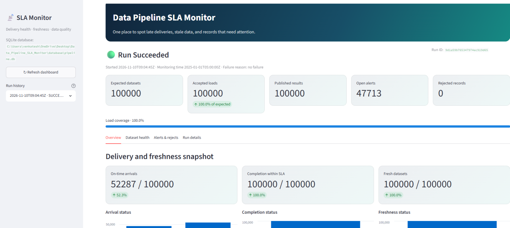
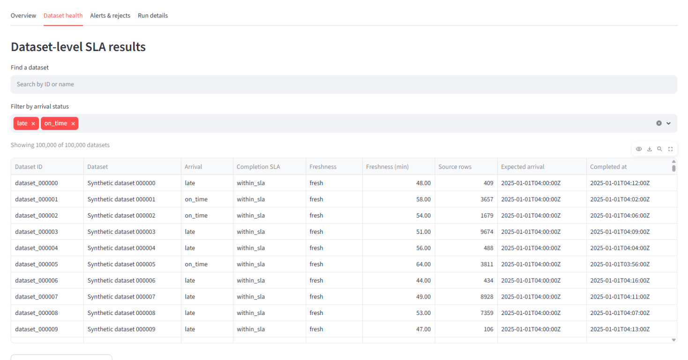
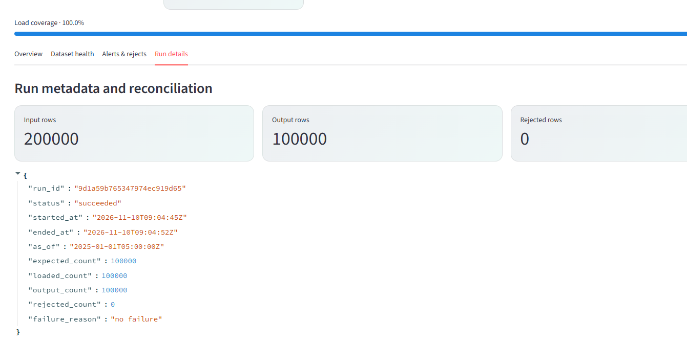

# Data Pipeline SLA Monitor

A local data-engineering project that tracks expected dataset arrivals, completion SLAs, freshness, rejected records, and operator alerts. It uses SQLite as its only database, so no database server, account, or credentials are required. Python 3.11 or 3.12 is supported.

## What it does

1. Reads a schedule of expected deliveries and observed load events from CSV.
2. Validates schemas, required values, timestamps, numeric constraints, duplicate keys, and dataset references.
3. Quarantines invalid records with their source file, line number, raw values, and reason.
4. Calculates arrival lateness, completion-SLA breaches, and freshness by dataset.
5. Persists run metrics, dataset outcomes, rejects, and actionable alerts in SQLite and writes a JSON report.
6. Supports deterministic reruns, a scalable generator, reconciliation metrics, and an optional Streamlit dashboard.

## Architecture

```text
datasets.csv (expected schedule) ─┐
                                  ├─> validation + SLA calculation ─> SQLite
load_events.csv (observed loads) ─┘                                ├─ JSON report
                                                                   └─ Streamlit dashboard
```

The schedule is the source of truth for what is due. One batch has at most one expected delivery per dataset; multiple events for a scheduled dataset are quarantined instead of silently choosing one. The expected arrival timestamp is the arrival deadline. The completion deadline is `expected_arrival_at + completion_sla_minutes`. Freshness is `as_of - completed_at`. Equality with a deadline passes; times strictly after it are late, breached, or stale. Deliveries whose expected time is still in the future are `not_due`, not missing.

## Quick start (Windows PowerShell)

Install Python 3.11 or 3.12, then open a terminal in the project directory:

```powershell
python --version
python -m pip install -r requirements.txt
Copy-Item .env.example .env
python -m pytest -q
python -m sla_monitor generate-sample --output-dir data/sample
python -m sla_monitor run `
  --datasets data/sample/datasets.csv `
  --loads data/sample/load_events.csv `
  --as-of 2025-01-01T05:00:00Z `
  --report outputs/sample_report.json
```

SQLite is included with Python. The default database is `database/pipeline.db`. To choose another SQLite file, edit `.env`:

```text
SQLITE_DB_PATH=database/pipeline.db
```

An absolute path is also accepted. A relative path is resolved from the project directory. The CLI accepts `--db <sqlite-file>` on `run` and `report` to override the configured path.

The explicit [SQLite schema](database/schema.sql) is provided for inspection or manual initialization; the application creates any missing tables and indexes automatically.

## Dashboard

Start the optional local dashboard after a run:

```powershell
streamlit run app.py
```

The dashboard provides recent-run selection, summary metrics, arrival/completion/freshness charts, dataset search and status filters, severity-filtered alerts, and raw reject inspection. Large result sets are paginated so the dashboard does not need to load an entire 100,000-dataset run into memory at once. CSV downloads contain the currently displayed page.

### Dashboard screenshots

The following screenshots show a sample 100,000-dataset run:

**Overview** — run status, load coverage, alerts, and arrival, completion, and freshness summaries.



**Dataset health** — searchable, filterable, paginated dataset results with freshness and SLA details.



**Run details** — reconciliation counts and run metadata.



## Sample and larger runs

The sample is intentionally mixed: it includes an on-time delivery, a late arrival, a completion-SLA breach, a missing dataset, a negative row count, a duplicate load key, an unknown dataset reference, and a malformed timestamp. Reject rows identify their source file and CSV line.

Generate and run a larger valid batch:

```powershell
python -m sla_monitor generate-large --output-dir data/generated --records 100000 --seed 42
python -m sla_monitor run `
  --datasets data/generated/datasets.csv `
  --loads data/generated/load_events.csv `
  --as-of 2025-01-01T05:00:00Z `
  --report outputs/large_report.json
```

The fixed seed makes generated row values reproducible. A fixed `--as-of` makes comparisons across runs meaningful. To measure end-to-end processing (including validation and SQLite writes):

```powershell
python -m sla_monitor benchmark --records 100000 --seed 42
```

One benchmark in this workspace processed 100,000 scheduled datasets and 100,000 load events in 16.021 seconds (about 6,242 datasets per second), with 100,000 loaded and zero rejected. This is a local reference measurement, not a performance guarantee; it was measured with Python 3.14.6 on Windows, outside the project's declared Python 3.11/3.12 support range. Re-run the command on the supported interpreter and target machine for a representative result.

## Inputs and outputs

All names use `snake_case`; timestamps must be ISO-8601 and include a timezone (`Z` recommended). See [docs/data_dictionary.md](docs/data_dictionary.md) for field types, nullability, keys, relationships, and business rules.

| File | Grain | Key | Purpose |
|---|---|---|---|
| `datasets.csv` | One expected delivery per dataset per monitoring batch | `dataset_id` | Dataset label, due time, completion SLA, freshness SLA |
| `load_events.csv` | One observed load event | (`dataset_id`, `load_id`) | Arrival/completion timestamps, source record count, source file |

`row_count` describes the source load and can be zero. It is not a count of rows transformed by this monitor. Invalid records are retained in the reject table, not silently discarded. Expected-answer labels are not included in the input CSVs; the independently generated sample report documents expected outcomes.

The database contains four related tables: `runs`, `dataset_results`, `rejects`, and `alerts`. A successful run reports:

- `input_rows`: schedule rows plus observed event rows read;
- `expected_count`: valid dataset schedules;
- `loaded_count`: valid accepted load events;
- `output_count`: dataset result rows published (one per valid schedule);
- `rejected_count`: quarantined schedule or event records;
- start/end times, status, run ID, and a failure reason (`no failure` for successful runs).

For a successful run, `output_count = expected_count`. A row-level reject does not abort unrelated datasets. A missing or changed column, missing input file, or other batch-level failure marks the run `failed` and persists the failure reason. Query SQLite with Python or any SQLite client:

```sql
SELECT status, expected_count, loaded_count, output_count, rejected_count, failure_reason
FROM runs ORDER BY started_at DESC LIMIT 1;

SELECT arrival_status, completion_status, freshness_status, COUNT(*)
FROM dataset_results
GROUP BY arrival_status, completion_status, freshness_status;

SELECT reason_code, COUNT(*) FROM rejects GROUP BY reason_code;
SELECT severity, alert_code, COUNT(*) FROM alerts GROUP BY severity, alert_code;
```

## Idempotency, retries, and backfills

The run ID is a SHA-256 digest (shortened for display) of the pipeline version, both input file contents, and the UTC monitoring timestamp. Repeating a successful run with the same version, bytes, and time returns its saved result without adding rows. Editing either input, choosing a different monitoring time, or incrementing the pipeline version creates a new run and preserves history. A failed run can be retried with the same ID; its prior partial child rows are cleared before retry. Processing results are committed transactionally, while failed-run status and reason are persisted separately.

For a backfill, provide the historical schedule and events and set `--as-of` to the intended monitoring instant. Keep the original inputs and timestamp so the run can be reproduced.

## Design choices, limits, and next steps

- **SQLite storage:** serverless local persistence keeps setup reproducible and avoids credentials or network configuration. SQLite supports this single-process starter workload; high-concurrency multi-host deployments should move to a server database.
- **Batch grain:** one schedule row per dataset and one accepted event per scheduled dataset. A real hourly/daily scheduler should add a schedule interval key such as `(dataset_id, scheduled_at)`.
- **Deterministic first accepted record:** later events for the same schedule are quarantined. A production policy could instead use source sequence numbers or explicit correction events.
- **Operational scope:** this is a batch monitor, not a daemon, scheduler, distributed locking service, or notification integration. Alerts are persisted and included in JSON; operators decide how to route them.
- **Optimization:** validation is performed in memory and rows are bulk inserted through SQLAlchemy; run keys are indexed to support history queries. Benchmark results vary by machine, filesystem, and input size.

## Project layout

- `sla_monitor/`: pipeline, CLI, SQLite storage, generators, and configuration.
- `app.py`: optional Streamlit dashboard.
- `tests/`: automated checks for normal, empty, malformed, duplicate, null, schema-change, idempotency, referential, timestamp-order, SLA-boundary, future-event, and SQLite persistence behavior.
- `data/sample/`: reproducible synthetic inputs.
- `database/schema.sql`: SQLite DDL; `database/pipeline.db`: default local database.
- `outputs/sample_report.json`: generated example report.
- `docs/data_dictionary.md`: source and target schema and field rules.
- `docs/design_decisions.md`: persistence, idempotency, SLA, and scope trade-offs.

All sample records are synthetic. Do not commit credentials or sensitive data.
